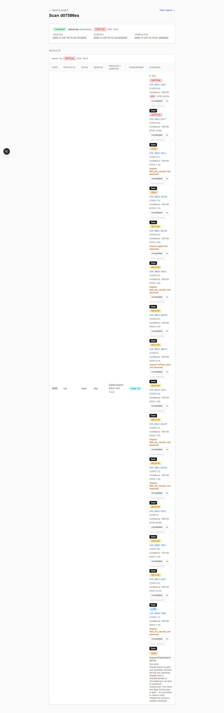
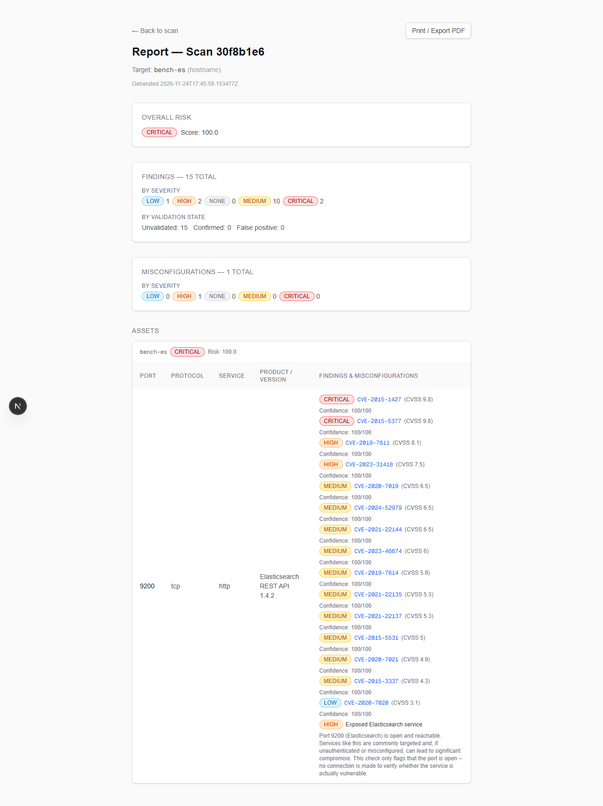
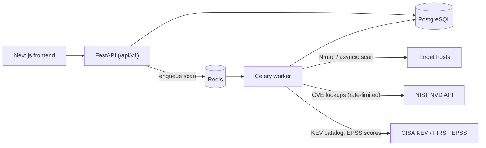

# VulnSight

[](https://github.com/dragonday3/vulnsight/actions/workflows/ci.yml)

**Evidence-Based Vulnerability Assessment & Risk Prioritization Platform.**

VulnSight discovers what is running on a host, matches it to known CVEs, checks for common misconfigurations, and ranks risk by how *confident* the evidence is, not just by CVSS. Every finding keeps the evidence behind it, and an analyst can confirm it or mark it a false positive.

| Scan results | Report |
|---|---|
|  |  |

*Both pages show the Elasticsearch 1.4.2 benchmark target (see [Benchmark](#benchmark)).*

## Features

- **6-stage asynchronous scan pipeline** run by Celery workers: discovery → service fingerprinting → misconfiguration analysis → CVE correlation → risk analysis → report generation
- **Discovery:** native asyncio port scanner, or Nmap `-sV` service/version detection (per-scan setting)
- **CVE correlation:** fingerprinted services → CPE 2.3 → [NIST NVD CVE API](https://nvd.nist.gov/developers/vulnerabilities); parses CVSS v4.0, v3.1, v3.0 and v2 metrics; 7-day CVE cache in PostgreSQL
- **Correlation completeness:** each scan records how many CVE lookups did not complete (failed, not stored, or truncated), and the scan and report pages warn when the count is above zero
- **Exploit likelihood:** every matched CVE is enriched with [CISA KEV](https://www.cisa.gov/known-exploited-vulnerabilities-catalog) membership and its [FIRST EPSS](https://www.first.org/epss/) score (both cached for 24 h), and these drive half of each finding's risk contribution
- **Applicability flags:** a CVE whose description names a prerequisite feature (HTTP/2, TLS, mod_proxy, DIGEST auth, ...) that wasn't observed on the target is flagged "requires X (not observed)" and discounted; it stays visible
- **Shared NVD rate limiting:** a Redis + Lua atomic sliding-window limiter keeps every worker process within NVD's public limit of 5 requests per 30 seconds
- **Evidence confidence (0–100):** Nmap-probed service matches always outrank port-table guesses
- **Analyst validation:** findings are `unvalidated`, `confirmed` or `false_positive`; false positives drop out of risk scoring
- **Misconfiguration checks:**
  - missing security headers (HSTS, CSP, X-Frame-Options, X-Content-Type-Options) and `Server` version disclosure
  - TLS: self-signed, expired and soon-to-expire certificates; weak protocols (SSLv2, SSLv3, TLS 1.0, TLS 1.1)
  - 12 sensitive exposed services (Telnet, FTP, SMB, RDP, VNC, Redis, MongoDB, Elasticsearch, Memcached, MySQL, PostgreSQL, Docker Engine API)
- **Risk scoring:** per-asset and per-scan 0–100 score with CRITICAL / HIGH / MEDIUM / LOW tiers (see below); duplicate CVEs from overlapping CPE matches are counted once
- **Reports:** per-scan summary (risk, findings by severity and validation state, per-asset/per-service CVEs and misconfigurations) via API and a report page
- **Quality:** 291 test functions (423 pytest cases with parametrization); GitHub Actions CI runs pytest (with PostgreSQL, Redis and Nmap), ruff, black, mypy, and the Next.js lint/build

## Architecture



## How risk is scored

1. **Per finding:** `contribution = (0.5 x severity + 0.5 x 100 x exploit) x confidence / 100 x applicability`, where:
   - `severity` = CVSS x 10, or a severity weight when there is no CVSS (CRITICAL 90, HIGH 70, MEDIUM 40, LOW 15);
   - `exploit` = 1.0 if the CVE is in CISA KEV, else its EPSS probability, else 0;
   - `applicability` = 0.3 when the CVE needs a prerequisite feature that wasn't observed on the target, else 1.0.

   False positives contribute 0. These constants were fixed in advance in
   [`benchmarks/phase10-preregistration.md`](benchmarks/phase10-preregistration.md).
2. **Per misconfiguration:** the same severity weight x 0.6, since a misconfiguration is a weaker signal than a matched CVE.
3. **Aggregation (noisy-OR):** treat each contribution as a probability *p* and combine `risk = 1 - (1 - p1)(1 - p2)...(1 - pn)`, scaled to 0-100. One severe issue dominates, and many small issues add up without exceeding 100. Assets are scored from their findings, and scans from their assets.
4. **Tiers:** >= 75 CRITICAL, >= 50 HIGH, >= 25 MEDIUM, > 0 LOW, 0 NONE.

The weights live in `backend/app/modules/risk/scoring_config.py`.

## Benchmark

VulnSight was measured against 8 deliberately vulnerable
[vulhub](https://github.com/vulhub/vulhub) containers:
- each image is pinned by digest and documents a known CVE;
- each is scanned with Nmap on the app's internal Docker network.

The expected CVE per target was committed in
[`benchmarks/expected.json`](benchmarks/expected.json) before the first
scan. The harness and all result files are in [`benchmarks/`](benchmarks/).

The numbers below come from
[run 6](benchmarks/results/2026-11-24-run6.md):
- it was the final-code run, with a cold CVE cache;
- every NVD lookup succeeded and was stored;
- 726 version-applicable CVEs were matched.

Every earlier run is listed in the
[results index](benchmarks/results/README.md).

**Result: 6 of 8 documented CVEs detected.** Both misses trace to gaps in
NVD's own configuration data:
- CVE-2017-12615 is listed only for Tomcat 7.0.x, though vulhub
  demonstrates it on 8.5.19.
- CVE-2012-2122 is listed for MySQL up to 5.5.21, though the advisory
  covers releases before 5.5.24.

**Most top-ranked matches don't apply to the target as configured.**
- Version matching finds the documented CVE, but most top-ranked matches
  need features the target doesn't enable (HTTP/2, mod_proxy, mod_lua,
  TLS, DIGEST authentication).
- In a [manual audit](benchmarks/results/2026-11-24-run6-audit.md) of
  each target's top 10 findings, done with the containers' actual config
  checked:
  - 15 of 80 were applicable;
  - 49 were not applicable;
  - 16 were unclear.
- One label in that audit was later found to be wrong and corrected (see
  [errata](benchmarks/results/ERRATA.md)). The published totals were
  16/48/16.
- This is a limit of version-based CVE matching in general, not only
  VulnSight's.

Ranks are shown as best–worst, because many CVEs share the same score.
For example, CVE-2021-41773 is tied at CVSS 9.8 with 14 others. The
VulnSight column is from the Phase 10 run (exploit likelihood +
applicability, see below). In Phase 9 it was identical to CVSS-only.

| Target | Documented CVE | Detected | Rank, CVSS-only | Rank, VulnSight (Phase 10) |
|---|---|---|---|---|
| Apache httpd 2.4.49 | CVE-2021-41773 | yes | 1–15 of 88 | 1–2 of 88 |
| Apache Tomcat 8.5.19 | CVE-2017-12615 | no: not in NVD's config for 8.5.x\* | - | - |
| Apache Tomcat 9.0.30 | CVE-2020-1938 | yes | 1–9 of 77 | 1 of 77 |
| nginx 1.13.2 | CVE-2017-7529 | yes | 3–8 of 15 | 1 of 15 |
| Elasticsearch 1.4.2 | CVE-2015-1427 | yes | 1–2 of 15 | 1 of 15 |
| Elasticsearch 1.1.1 | CVE-2014-3120 | yes | 3–4 of 17 | 2 of 17 |
| Jetty 9.4.37 | CVE-2021-28164 | yes | 12–18 of 26 | 2 of 26 |
| MySQL 5.5.23 | CVE-2012-2122 | no: not in NVD's config for 5.5.23\* | - | - |

\* Classified as "not version-matchable" by checking NVD after the run,
so 6 of 6 version-matchable is a post-hoc figure, not the headline.
All 422 of MySQL's matched CVEs were fetched, so this miss isn't a
truncation artefact.

**Disclosure: these numbers are benchmark-informed.**
- The first run scored **2 of 8**. Investigating it found four real bugs,
  each fixed in its own commit:
  - nmap and NVD use different vendor names for nginx, Elasticsearch,
    Jetty and MySQL;
  - the NVD client's 10 s timeout was shorter than NVD's ~13 s response
    time;
  - full-length CVSS v4.0 vectors overflowed a 100-character column,
    silently dropping every CVE for that product;
  - none of these failures were visible on the scan.
- The review of these fixes found a fifth: lookups with more than 200
  CVEs were cut off. That one is fixed too (pagination).
- One run at the final code (run 5) was marked INVALID. NVD
  rate-limited one lookup, so ES 1.4.2's CVE was missed. It was repeated
  with no code change, as run 6.
- Every run is kept as recorded in `benchmarks/results/`. None of them is
  a blind or held-out measurement.

### Phase 10: exploit likelihood and applicability

Before any code was written, the following were committed in
[`benchmarks/phase10-preregistration.md`](benchmarks/phase10-preregistration.md):
- the scoring formula and its constants;
- four metrics with pass/fail criteria;
- 3 new **held-out** targets (nginx 1.4.2, php 5.4.1-cgi, postgres
  9.6.7) that had never been scanned or audited.

Applicability labels for CVEs not covered by the Phase 9 audit were made
**blind**:
- by a fresh-context agent;
- from a sheet holding only each CVE's id and description, plus raw
  container config facts;
- with no score, rank, flag or rule list in view.

Everything is in [`benchmarks/results/`](benchmarks/results/) under
`2026-11-24-1914-*`. The [metrics file](benchmarks/results/2026-11-24-1914-metrics.md)
reports them verbatim, including what failed:

| Metric (pre-registered) | Result | Criterion |
|---|---|---|
| M1: rank of the documented CVEs | VulnSight mean 1.3–1.5 vs CVSS-only 3.5–9.3 | **met** |
| M2: not-applicable CVEs in each top 10, original 8 targets (in-sample) | 25 of 80, down from 49; applicable up from 15 to 29 | **met** (N ≤ 36 and A ≥ 16). **Not met** under the pre-registered worst case (unclear counted as not applicable: 38) |
| M2-heldout: same, on the 3 never-audited targets (out-of-sample) | VulnSight 20 not applicable, 4 applicable vs CVSS-only 24 and 5 | **not met** (needed ≤ 18 with applicable not lower) |
| M3: harm | No documented CVE flagged or ranked worse; 135 of 726 matches flagged (21 rule features) | reported |
| M4: recall | 6 of 8 kept; held-out 2 of 3 (php's CGI version isn't visible to Nmap) | **met** |

**What this does and doesn't show.**
- KEV/EPSS moves the documented, known-exploited CVEs to the top. That is
  expected by construction: vulhub picks famous exploited CVEs, and their
  KEV/EPSS values were seen before the weights were fixed. It shows the
  ordering does what KEV/EPSS is meant to do, not general ranking skill.
- The applicability rules cut not-applicable matches on the targets they
  were written from. On the held-out targets they showed **no measurable
  improvement**:
  - not applicable fell from 24 to 20;
  - unclear rose from 1 to 6;
  - applicable fell from 5 to 4.
- The CVSS-only top 10 breaks CVSS ties at the cut-off by CVE id, so that
  baseline list is one choice among equals. Tied CVEs left out per target:
  - php 9, tomcat9 6, httpd 5;
  - mysql 2;
  - tomcat 1, es 1.
- The held-out claim also required the CVSS-only baseline to have at
  least one not-applicable CVE. That condition is stricter than the
  pre-registration, and it made no difference here (baseline N was 24).
- Only the labeller was blind. The container-facts file it worked from
  was written by the same session that built the rules, after seeing the
  first (invalid) Phase 10 run's top-10 lists. Its Jetty section was
  added after the first labelling pass came back all-unclear for Jetty.
- Only TLS is observable today. HTTP/2 and modules never are, so a
  flagged CVE means "not seen", not "absent".
- The first Phase 10 run was INVALID: concurrent scans hit NVD rate
  limits. The harness now runs scans one at a time (harness change only),
  and the valid run used the same app code.

## API

All routes are under `/api/v1` (interactive docs at `/docs`).

| Method | Route | Purpose |
|---|---|---|
| `GET` | `/health` | Health check |
| `POST` / `GET` | `/projects` | Create / list projects |
| `GET` / `PATCH` / `DELETE` | `/projects/{project_id}` | Read / update / delete a project |
| `POST` / `GET` | `/projects/{project_id}/targets` | Add / list targets |
| `GET` | `/projects/{project_id}/targets/{target_id}` | Read a target |
| `POST` / `GET` | `/scans` | Start / list scans |
| `GET` | `/scans/{scan_id}`, `/scans/{scan_id}/status` | Scan details and pipeline stage |
| `POST` | `/scans/{scan_id}/cancel` | Cancel a scan |
| `GET` | `/scans/{scan_id}/assets` | Assets, services, findings and misconfigurations |
| `GET` | `/scans/{scan_id}/report` | Scan report |
| `PATCH` | `/findings/{finding_id}` | Set validation state (confirmed / false positive) |

## Quick Start

### Prerequisites

- [Docker Desktop](https://www.docker.com/products/docker-desktop/) (includes
  Docker Compose). No local Python/Node/Postgres install is required — the
  whole stack runs in containers.

### Run it

```bash
cp .env.example .env
docker compose up --build
```

This starts five services: `postgres`, `redis`, `backend` (FastAPI, hot
reload), `worker` (Celery worker — actually executes scans), and `frontend`
(Next.js dev server, hot reload).

Scans are not run inline by the API process: `POST /scans` enqueues a task
onto `redis` (used here as the Celery broker) and the `worker` service picks
it up and runs the actual port scan (native asyncio-based by default, or
`nmap` if a scan's `config.scanner` is set to `"nmap"`). `nmap` is installed
inside the backend/worker Docker image itself — there's nothing to install
on the host.

The `worker` container does **not** hot-reload on code changes the way
`backend` and `frontend` do. After editing worker/task code, pick the
change up with:

```bash
docker compose restart worker
```

### Apply the database migration

Once the stack is up, run the schema migration **manually**:

```bash
docker compose exec backend alembic upgrade head
```

This is a deliberate manual step, not something run automatically on
container start. If migrations ran automatically at startup and one failed,
the backend container would either crash-loop with an unhelpful error or
silently keep running against a stale/partial schema — either way the
failure is masked behind a generic "container didn't come up" symptom
instead of a clear `alembic upgrade head` error you can act on directly.

### URLs

| Service | URL |
|---|---|
| Frontend | http://localhost:3000 |
| Backend API docs (Swagger UI) | http://localhost:8000/docs |
| Backend health check | http://localhost:8000/api/v1/health |

### Verification commands

`backend/requirements.txt` lists runtime-only dependencies; test/lint/type
tooling (pytest, ruff, black, mypy, httpx) lives in
`backend/requirements-dev.txt` — install both for local development or CI
(`pip install -r requirements.txt -r requirements-dev.txt`); the Docker
image already installs both, so the commands below work as-is inside the
container.

Run from `backend/` (inside the container, e.g. `docker compose exec backend
<command>`, or on the host if you have a local Python env set up):

```bash
pytest -v
ruff check .
black --check .
mypy app
```

Run from `frontend/`:

```bash
next lint
next build --webpack
```

`.github/workflows/ci.yml` runs all of the above (plus `pytest`'s own
Postgres/Redis as GitHub Actions service containers, and `nmap` installed on
the runner so `test_nmap_scanner.py` isn't skipped) on every push to `main`
and every pull request. Frontend type-checking runs via `next build`, not a
standalone `tsc --noEmit`: this project uses Next's typed routes, and the
`PageProps`/`LayoutProps` globals they rely on are only generated by
`next build`/`next dev` itself — a bare `tsc` against a checkout that was
never built fails on every dynamic route with `Cannot find name
'PageProps'`, which isn't a real type error.

### Windows-specific notes

1. **`node_modules` anonymous volume is required.** The frontend service in
   `docker-compose.yml` mounts an anonymous volume on `/app/node_modules` on
   top of the bind-mounted source tree. Without it, Windows bind-mounting
   over the container's Linux-built `node_modules` breaks native binaries
   (e.g. `@next/swc`) — don't remove that volume entry.
2. **Line endings.** `.gitattributes` (`* text=auto eol=lf`) normalizes
   checked-out files to LF, which avoids CRLF breaking shell steps and
   Alpine-based images in Docker.
3. **Slow hot reload over Windows bind mounts.** `uvicorn --reload` and the
   Next.js dev server's file-watching can be slow (or occasionally miss
   changes entirely) over Windows bind mounts. If hot reload doesn't fire
   promptly, uncomment the polling fallbacks in `.env`:
   `WATCHFILES_FORCE_POLLING=true` (backend) and `WATCHPACK_POLLING=true`
   (frontend), then restart the stack.
4. **Port collisions.** Ports `5432` (Postgres) and `6379` (Redis) commonly
   collide with an existing local install of either. If `docker compose up`
   fails to bind one of those ports, remap it in `docker-compose.yml`, e.g.
   change `"5432:5432"` to `"5433:5432"` (left side is the host port), and
   update `DATABASE_URL`/`TEST_DATABASE_URL` accordingly if you connect from
   the host.
5. **Save `.env` as UTF-8 without BOM.** Notepad defaults to UTF-8 *with* a
   byte-order mark, which breaks `pydantic-settings`' dotenv parsing (the
   BOM bytes end up prepended to the first variable name). Use an editor
   that lets you choose "UTF-8" (no BOM) explicitly, or `cp .env.example
   .env` as above and edit values without re-saving through Notepad's
   default encoding.
6. **Turbopack route-discovery bug under Windows Docker bind mounts.**
   `frontend/package.json`'s `dev` and `build` scripts both pass
   `--webpack`, forcing the classic webpack bundler instead of Next 16's
   default Turbopack. Without it, a route nested two dynamic segments deep
   under a static path segment (e.g.
   `/projects/[projectId]/scans/[scanId]`) 404s on every request — even on
   a fully cold start with no cache — and the route is missing from
   `next dev`'s own auto-generated `.next/types/routes.d.ts` too, which
   points at a route-discovery bug rather than a dev-server/HMR quirk.
   This matches known upstream Turbopack/Next 16 issues with nested dynamic
   routes on Windows Docker bind mounts (inotify file-watch events not
   propagating into the container). If a future Next/Turbopack upgrade
   fixes this, both `--webpack` flags can likely be dropped — reverify the
   affected route still resolves under Turbopack first.

## Limitations and roadmap

- No user accounts or authentication yet: run it locally or on a trusted network only.
- Applicability flags are keyword rules over NVD descriptions. Only TLS is observable (from Nmap). On held-out targets they didn't meet the pre-registered improvement bar (see Benchmark).
- KEV/EPSS weighting ranks known-exploited CVEs first. The benchmark shows the mechanism works, not that it ranks better than CVSS in general.
- Reports are JSON and a web page; no PDF export yet.
- Scoring weights are first-pass judgement calls, not tuned against large real-world scan data.
- CVE matching is version-based. It can't tell whether the vulnerable
  module or feature is enabled, so most matches are version-applicable
  rather than exploitable (see Benchmark).
- The NVD client fetches up to 5 pages (1,000 CVEs) per CPE. Beyond that,
  the lookup is marked incomplete on the scan.
- nmap-to-NVD vendor renames are a small hand-kept table
  (`cpe_utils.nvd_aliases`). Other renamed products will still be missed
  until they are added.
- Nmap scans the top 1000 ports only.

## Responsible Use

VulnSight is intended strictly for authorized security testing: penetration
tests, security assessments, lab environments, CTFs, and infrastructure you
own or are explicitly permitted to assess. It does not perform autonomous
exploitation.
