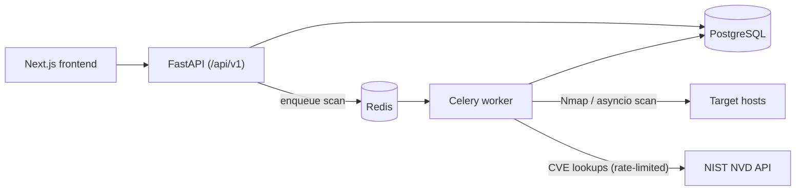

# VulnSight

[](https://github.com/dragonday3/vulnerablescanner/actions/workflows/ci.yml)

**Evidence-Based Vulnerability Assessment & Risk Prioritization Platform.**

VulnSight discovers what is running on a host, matches it to known CVEs, checks for common misconfigurations, and ranks risk by how *confident* the evidence is, not just by CVSS. Every finding keeps the evidence behind it, and an analyst can confirm it or mark it a false positive.

## Features

- **6-stage asynchronous scan pipeline** run by Celery workers: discovery → service fingerprinting → misconfiguration analysis → CVE correlation → risk analysis → report generation
- **Discovery:** native asyncio port scanner, or Nmap `-sV` service/version detection (per-scan setting)
- **CVE correlation:** fingerprinted services → CPE 2.3 → [NIST NVD CVE API](https://nvd.nist.gov/developers/vulnerabilities); parses CVSS v4.0, v3.1, v3.0 and v2 metrics; 7-day CVE cache in PostgreSQL
- **Shared NVD rate limiting:** a Redis + Lua atomic sliding-window limiter keeps every worker process within NVD's public limit of 5 requests per 30 seconds
- **Evidence confidence (0–100):** Nmap-probed service matches always outrank port-table guesses
- **Analyst validation:** findings are `unvalidated`, `confirmed` or `false_positive`; false positives drop out of risk scoring
- **Misconfiguration checks:**
  - missing security headers (HSTS, CSP, X-Frame-Options, X-Content-Type-Options) and `Server` version disclosure
  - TLS: self-signed, expired and soon-to-expire certificates; weak protocols (SSLv2, SSLv3, TLS 1.0, TLS 1.1)
  - 12 sensitive exposed services (Telnet, FTP, SMB, RDP, VNC, Redis, MongoDB, Elasticsearch, Memcached, MySQL, PostgreSQL, Docker Engine API)
- **Risk scoring:** per-asset and per-scan 0–100 score with CRITICAL / HIGH / MEDIUM / LOW tiers (see below); duplicate CVEs from overlapping CPE matches are counted once
- **Reports:** per-scan summary (risk, findings by severity and validation state, per-asset/per-service CVEs and misconfigurations) via API and a report page
- **Quality:** 259 automated tests; GitHub Actions CI runs pytest (with PostgreSQL, Redis and Nmap), ruff, black, mypy, and the Next.js lint/build

## Architecture



## How risk is scored

1. **Per finding:** `contribution = CVSS (0-10) x 10 x confidence / 100`. A finding with no CVSS falls back to a severity weight (CRITICAL 90, HIGH 70, MEDIUM 40, LOW 15). False positives contribute 0.
2. **Per misconfiguration:** the same severity weight x 0.6, since a misconfiguration is a weaker signal than a matched CVE.
3. **Aggregation (noisy-OR):** treat each contribution as a probability *p* and combine `risk = 1 - (1 - p1)(1 - p2)...(1 - pn)`, scaled to 0-100. One severe issue dominates, and many small issues add up without exceeding 100. Assets are scored from their findings, and scans from their assets.
4. **Tiers:** >= 75 CRITICAL, >= 50 HIGH, >= 25 MEDIUM, > 0 LOW, 0 NONE.

The weights live in `backend/app/modules/risk/scoring_config.py`.

## API

All routes are under `/api/v1` (interactive docs at `/docs`).

| Method | Route | Purpose |
|---|---|---|
| `GET` | `/health` | Health check |
| `POST` / `GET` | `/projects` | Create / list projects |
| `GET` / `PATCH` / `DELETE` | `/projects/{project_id}` | Read / update / delete a project |
| `POST` / `GET` | `/projects/{project_id}/targets` | Add / list targets |
| `GET` | `/projects/{project_id}/targets/{target_id}` | Read a target |
| `POST` / `GET` | `/scans` | Start / list scans |
| `GET` | `/scans/{scan_id}`, `/scans/{scan_id}/status` | Scan details and pipeline stage |
| `POST` | `/scans/{scan_id}/cancel` | Cancel a scan |
| `GET` | `/scans/{scan_id}/assets` | Assets, services, findings and misconfigurations |
| `GET` | `/scans/{scan_id}/report` | Scan report |
| `PATCH` | `/findings/{finding_id}` | Set validation state (confirmed / false positive) |

## Quick Start

### Prerequisites

- [Docker Desktop](https://www.docker.com/products/docker-desktop/) (includes
  Docker Compose). No local Python/Node/Postgres install is required — the
  whole stack runs in containers.

### Run it

```bash
cp .env.example .env
docker compose up --build
```

This starts five services: `postgres`, `redis`, `backend` (FastAPI, hot
reload), `worker` (Celery worker — actually executes scans), and `frontend`
(Next.js dev server, hot reload).

Scans are not run inline by the API process: `POST /scans` enqueues a task
onto `redis` (used here as the Celery broker) and the `worker` service picks
it up and runs the actual port scan (native asyncio-based by default, or
`nmap` if a scan's `config.scanner` is set to `"nmap"`). `nmap` is installed
inside the backend/worker Docker image itself — there's nothing to install
on the host.

The `worker` container does **not** hot-reload on code changes the way
`backend` and `frontend` do. After editing worker/task code, pick the
change up with:

```bash
docker compose restart worker
```

### Apply the database migration

Once the stack is up, run the schema migration **manually**:

```bash
docker compose exec backend alembic upgrade head
```

This is a deliberate manual step, not something run automatically on
container start. If migrations ran automatically at startup and one failed,
the backend container would either crash-loop with an unhelpful error or
silently keep running against a stale/partial schema — either way the
failure is masked behind a generic "container didn't come up" symptom
instead of a clear `alembic upgrade head` error you can act on directly.

### URLs

| Service | URL |
|---|---|
| Frontend | http://localhost:3000 |
| Backend API docs (Swagger UI) | http://localhost:8000/docs |
| Backend health check | http://localhost:8000/api/v1/health |

### Verification commands

`backend/requirements.txt` lists runtime-only dependencies; test/lint/type
tooling (pytest, ruff, black, mypy, httpx) lives in
`backend/requirements-dev.txt` — install both for local development or CI
(`pip install -r requirements.txt -r requirements-dev.txt`); the Docker
image already installs both, so the commands below work as-is inside the
container.

Run from `backend/` (inside the container, e.g. `docker compose exec backend
<command>`, or on the host if you have a local Python env set up):

```bash
pytest -v
ruff check .
black --check .
mypy app
```

Run from `frontend/`:

```bash
next lint
next build --webpack
```

`.github/workflows/ci.yml` runs all of the above (plus `pytest`'s own
Postgres/Redis as GitHub Actions service containers, and `nmap` installed on
the runner so `test_nmap_scanner.py` isn't skipped) on every push to `main`
and every pull request. Frontend type-checking runs via `next build`, not a
standalone `tsc --noEmit`: this project uses Next's typed routes, and the
`PageProps`/`LayoutProps` globals they rely on are only generated by
`next build`/`next dev` itself — a bare `tsc` against a checkout that was
never built fails on every dynamic route with `Cannot find name
'PageProps'`, which isn't a real type error.

### Windows-specific notes

1. **`node_modules` anonymous volume is required.** The frontend service in
   `docker-compose.yml` mounts an anonymous volume on `/app/node_modules` on
   top of the bind-mounted source tree. Without it, Windows bind-mounting
   over the container's Linux-built `node_modules` breaks native binaries
   (e.g. `@next/swc`) — don't remove that volume entry.
2. **Line endings.** `.gitattributes` (`* text=auto eol=lf`) normalizes
   checked-out files to LF, which avoids CRLF breaking shell steps and
   Alpine-based images in Docker.
3. **Slow hot reload over Windows bind mounts.** `uvicorn --reload` and the
   Next.js dev server's file-watching can be slow (or occasionally miss
   changes entirely) over Windows bind mounts. If hot reload doesn't fire
   promptly, uncomment the polling fallbacks in `.env`:
   `WATCHFILES_FORCE_POLLING=true` (backend) and `WATCHPACK_POLLING=true`
   (frontend), then restart the stack.
4. **Port collisions.** Ports `5432` (Postgres) and `6379` (Redis) commonly
   collide with an existing local install of either. If `docker compose up`
   fails to bind one of those ports, remap it in `docker-compose.yml`, e.g.
   change `"5432:5432"` to `"5433:5432"` (left side is the host port), and
   update `DATABASE_URL`/`TEST_DATABASE_URL` accordingly if you connect from
   the host.
5. **Save `.env` as UTF-8 without BOM.** Notepad defaults to UTF-8 *with* a
   byte-order mark, which breaks `pydantic-settings`' dotenv parsing (the
   BOM bytes end up prepended to the first variable name). Use an editor
   that lets you choose "UTF-8" (no BOM) explicitly, or `cp .env.example
   .env` as above and edit values without re-saving through Notepad's
   default encoding.
6. **Turbopack route-discovery bug under Windows Docker bind mounts.**
   `frontend/package.json`'s `dev` and `build` scripts both pass
   `--webpack`, forcing the classic webpack bundler instead of Next 16's
   default Turbopack. Without it, a route nested two dynamic segments deep
   under a static path segment (e.g.
   `/projects/[projectId]/scans/[scanId]`) 404s on every request — even on
   a fully cold start with no cache — and the route is missing from
   `next dev`'s own auto-generated `.next/types/routes.d.ts` too, which
   points at a route-discovery bug rather than a dev-server/HMR quirk.
   This matches known upstream Turbopack/Next 16 issues with nested dynamic
   routes on Windows Docker bind mounts (inotify file-watch events not
   propagating into the container). If a future Next/Turbopack upgrade
   fixes this, both `--webpack` flags can likely be dropped — reverify the
   affected route still resolves under Turbopack first.

## Limitations and roadmap

- No user accounts or authentication yet: run it locally or on a trusted network only.
- Prioritisation uses CVSS and evidence confidence; exploit likelihood (EPSS) and CISA KEV are not used yet.
- Reports are JSON and a web page; no PDF export yet.
- Scoring weights are first-pass judgement calls, not tuned against large real-world scan data.

## Responsible Use

VulnSight is intended strictly for authorized security testing: penetration
tests, security assessments, lab environments, CTFs, and infrastructure you
own or are explicitly permitted to assess. It does not perform autonomous
exploitation.
